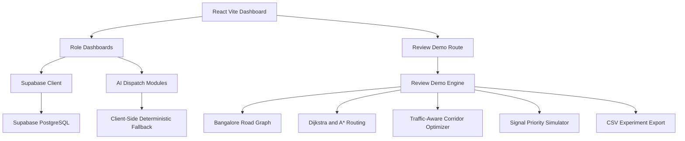

# AmbuNet V2.0 Architecture Notes

## 2026-10-22 correction

The [feature audit](feature-audit.md) supersedes earlier completion claims below. Routing selects paths using distance or exported Random Forest predictions; evaluation uses the same per-road seeded synthetic demand. No automatic congestion discount is applied to AmbuNet. Response means arrival at the incident, with hospital transport measured separately. Segment playback uses travel durations and modeled signal waits. Minimum phase (10s), yellow (3s), and all-red (2s) are explicit synthetic assumptions, not measured intersection schedules.

`ml/train.py` fits and evaluates a Random Forest and writes a joblib model plus JSON tree export. `ml/app.py` serves local prediction and metrics endpoints. `trafficPredictor.ts` evaluates those same exported trees on Vercel. Node orchestration, SUMO, and operational security remain incomplete.

## Current Repository Audit

AmbuNet is currently a Vite + React + TypeScript application with Tailwind CSS, Leaflet maps, Recharts analytics, Supabase integration, and deterministic client-side AI modules.

Implemented before the V2.0 upgrade:

- Patient, driver, hospital staff, and admin role dashboards
- Supabase auth/data wiring with local fallback data
- Bangalore ambulance, hospital, bed, zone, and emergency seed data
- Live map rendering with hospitals, ambulances, incidents, and routes
- AI modules for triage, ETA adjustment, demand forecasting, bed probability, standby positioning, and dispatch scoring
- Admin simulation benchmark comparing baseline and adaptive dispatch
- Vitest coverage for the existing AI modules

Added in this upgrade:

- `/review-demo` route for the Review 2 engineering walkthrough
- Deterministic Koramangala road graph fallback digital twin
- Dijkstra, A*, and traffic-aware routing candidates
- Simulated emergency traffic-signal priority events
- Ambulance selection audit based on reproducible ETA calculations
- Hospital matching from seeded Bangalore hospital records
- Baseline vs AmbuNet metric comparison and CSV export
- Unit tests for routing, signal priority, deterministic scenario output, and export

## Runtime Architecture



## Review 2 Workflow


## Algorithm Notes

Baseline:

- Uses Dijkstra routing over the seeded road graph.
- Uses free-flow travel time plus normal signal delay.
- Does not apply predictive traffic optimization or signal priority.

AmbuNet optimized:

- Compares available ambulances by traffic-aware ETA.
- Applies traffic intensity, weather, and simulated vehicle-load multipliers.
- Reduces signal waiting only through labeled simulated priority events.
- Produces route, ETA, congestion delay, signal wait, and percentage improvement.

Improvement formula:

```text
((Baseline Time - AmbuNet Time) / Baseline Time) * 100
```

## Local Execution

```bash
npm install
npm run test
npm run dev
```

Open:

```text
http://localhost:5173/review-demo
```

## Limitations and Future Scope

- This repository does not currently contain a separate Node/Express backend, Socket.IO server, Python FastAPI service, or SUMO/TraCI bundle.
- The Review 2 demo is intentionally implemented as a lightweight deterministic fallback so it runs on a Windows development machine without paid APIs.
- Future backend work should move orchestration into Node.js APIs and keep the Python ML/digital-twin services behind explicit endpoints.
- SUMO integration should be added as an optional service with installation instructions, not silently required for the local demo.
